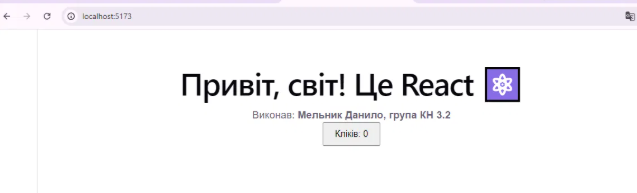
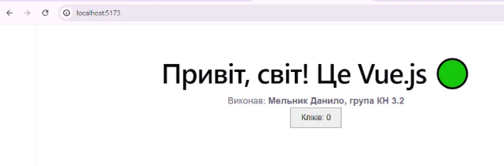
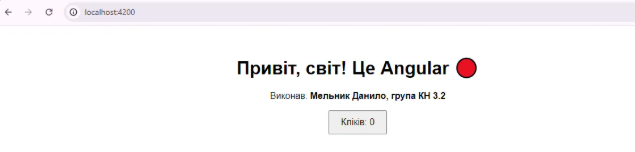

# Практична робота №1. Фреймворки JavaScript

Ознайомлення з сучасними фронтенд-фреймворками. Базові додатки на React, Vue.js та Angular.

**Виконав:** Мельник Данило, група КН 3.2

## Структура

- `react-app/` — React (Vite)
- `vue-app/` — Vue 3 (Vite, Composition API)
- `angular-app/` — Angular (Signals)

## Запуск

- React та Vue: `npm install`, потім `npm run dev` (http://localhost:5173)
- Angular: `npm install`, потім `npm start` (http://localhost:4200)

## Скріншоти

### React

### Vue.js

### Angular

